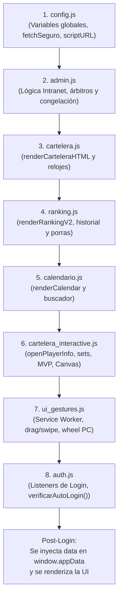

# 🧭 Guía de Arquitectura Frontend - Fantasy VCV

> **Documento de referencia para Desarrolladores y Agentes de IA.**  
> Este documento describe la estructura modular del frontend, la responsabilidad de cada archivo, el flujo de ejecución y las reglas obligatorias para modificar o ampliar el código sin romper dependencias.

---

## 1. 🏛️ Filosofía de Arquitectura

El frontend de **Fantasy VCV** evolucionó desde un archivo monolítico histórico de más de 11.000 líneas (`index.html`) hacia una arquitectura modular organizada por responsabilidades en [`dev.html`](file:///c:/Users/angel/Desktop/fantasy%20vcv%202627/Fantasy-VCV-2627/dev.html) y la carpeta [`js/`](file:///c:/Users/angel/Desktop/fantasy%20vcv%202627/Fantasy-VCV-2627/js/).

### ⚠️ Regla Fundamental del Runtime
Los módulos JavaScript en `js/` se cargan como **scripts estándar ordenados** (`<script src="js/...">`), **NO** mediante `<script type="module">`.
* **Motivo técnico:** Toda la interfaz genera decenas de bloques HTML dinámicos mediante *template literals* con controladores de eventos inline (`onclick="openPlayerInfo(...)"`, `onclick="cambiarPuntosV2(...)"`, etc.). El aislamiento léxico cerrado de los ES6 modules impediría que el DOM acceda a estas funciones globales.
* **Resultado:** Todo el código comparte un ámbito global sincronizado (`window`), pero con archivos limpios, desacoplados y fácilmente navegables.

---

## 2. 🗂️ Mapa de Archivos: ¿A dónde voy para modificar cada cosa?

Si necesitas hacer un cambio, consulta esta tabla para ir directamente al archivo correcto:

| ¿Qué quieres modificar o arreglar? | Archivo a editar | Líneas aprox. |
| :--- | :--- | :--- |
| **URL de la API Cloudflare D1, reintentos automáticos de red o utilidades de fecha/imagen** | [`js/config.js`](file:///c:/Users/angel/Desktop/fantasy%20vcv%202627/Fantasy-VCV-2627/js/config.js) | ~370 |
| **Inicio de sesión, modo invitado, auto-login persistente (`localStorage`) o cierre de sesión** | [`js/auth.js`](file:///c:/Users/angel/Desktop/fantasy%20vcv%202627/Fantasy-VCV-2627/js/auth.js) | ~796 |
| **Tarjetas de partidos de la cartelera y temporizadores de cuenta atrás** | [`js/cartelera.js`](file:///c:/Users/angel/Desktop/fantasy%20vcv%202627/Fantasy-VCV-2627/js/cartelera.js) | ~605 |
| **Interactividad de predicciones (sets, diferencias, empate), votación MVP y pop-up de estadísticas de usuario** | [`js/cartelera_interactive.js`](file:///c:/Users/angel/Desktop/fantasy%20vcv%202627/Fantasy-VCV-2627/js/cartelera_interactive.js) | ~3.290 |
| **Tabla de clasificación (General y ligas privadas), historial de jornadas o predicciones totales de temporada** | [`js/ranking.js`](file:///c:/Users/angel/Desktop/fantasy%20vcv%202627/Fantasy-VCV-2627/js/ranking.js) | ~727 |
| **Calendario anual de la temporada, buscador de partidos y filtro por equipo** | [`js/calendario.js`](file:///c:/Users/angel/Desktop/fantasy%20vcv%202627/Fantasy-VCV-2627/js/calendario.js) | ~289 |
| **Intranet de administración, resultados oficiales, monitoreo, gestión de árbitros y congelación** | [`js/admin.js`](file:///c:/Users/angel/Desktop/fantasy%20vcv%202627/Fantasy-VCV-2627/js/admin.js) | ~1.917 |
| **PWA Service Worker, soporte de ratón en PC o gestos táctiles de deslizamiento en móvil** | [`js/ui_gestures.js`](file:///c:/Users/angel/Desktop/fantasy%20vcv%202627/Fantasy-VCV-2627/js/ui_gestures.js) | ~188 |
| **Estructura HTML base, modales fijos (`playerInfoModal`, etc.) y estilos CSS generales** | [`dev.html`](file:///c:/Users/angel/Desktop/fantasy%20vcv%202627/Fantasy-VCV-2627/dev.html) | ~2.940 |

---

## 3. 🔄 Secuencia de Carga y Flujo del Ciclo de Vida

Al abrir la aplicación en el navegador, los scripts se ejecutan estrictamente en este orden:



### ¿Por qué `auth.js` va el último?
Al situar `auth.js` al final de la cola, cuando se procesa el formulario de login o el `verificarAutoLogin()` con credenciales recordadas en `localStorage`, todas las funciones visuales (`window.renderCarteleraHTML`, `window.renderRankingV2`, `window.initCalendar`, etc.) ya han sido leídas por el navegador y están 100% listas para dibujar los datos en pantalla sin condiciones de carrera.

---

## 4. 🔑 Diccionario de Funciones Globales Clave

Para localizar rápidamente dónde reside la lógica de cada operación:

| Función | Archivo | Descripción |
| :--- | :--- | :--- |
| `fetchSeguro(url, options, retries)` | `config.js` | Envía peticiones HTTP con anti-caché y reintento automático si hay un fallo de red o cold start. |
| `formatFecha(ts)` | `config.js` | Convierte un timestamp en fecha legible en español (`DD/MM, HH:mm`). |
| `sanitizeImgUrl(url)` | `config.js` | Sanitiza URLs de imágenes (soporte Imgur, HTTPS, etc.). |
| `cerrarSesionApp()` | `auth.js` | Limpia caché local, `localStorage` de sesión y devuelve al usuario al formulario de acceso. |
| `verificarAutoLogin()` | `auth.js` | Lee la sesión recordada y simula un acceso automático transparente en milisegundos. |
| `renderCarteleraHTML(data)` | `cartelera.js` | Construye todas las tarjetas de los partidos abiertos/cerrados de la jornada activa. |
| `iniciarRelojes()` | `cartelera.js` | Arranca el cronómetro de cuenta atrás regresiva para el cierre de predicciones. |
| `openPlayerInfo(jugador, liga)` | `cartelera_interactive.js` | Abre el modal flotante (`playerInfoModal`) con las estadísticas, medias y badges de un jugador. |
| `seleccionarSetV2(idPart, setVal)` | `cartelera_interactive.js` | Gestiona la selección del marcador de sets de un partido. |
| `cambiarPuntosV2(idPart, delta)` | `cartelera_interactive.js` | Suma o resta la diferencia de puntos pronosticada. |
| `votarMvpPartido(idPart, dorsal)` | `cartelera_interactive.js` | Registra el voto de MVP para un jugador nominado. |
| `switchTabV2(tabName)` | `cartelera_interactive.js` | Alterna entre las pestañas principales (*Cartelera*, *Clasificación*, *Calendario*). |
| `renderRankingV2()` | `ranking.js` | Dibuja el podio, la lista completa del ranking y el selector de ligas privadas. |
| `renderCalendar()` | `calendario.js` | Dibuja los partidos de toda la temporada según los filtros seleccionados. |
| `renderAdminPanel(equipos)` | `admin.js` | Dibuja la mesa de resultados para árbitros y administradores autorizados. |
| `guardarResultadoAdmin(...)` | `admin.js` | Guarda sets oficiales, parciales y estado final de un partido en Cloudflare D1. |
| `guardarAjusteLigasFreeze(...)` | `ui_gestures.js` | Aplica la congelación manual o automática de puntuaciones del fin de semana. |

---

## 5. 🛡️ Buenas Prácticas y Reglas de Desarrollo para IAs

Cualquier agente de IA o desarrollador que modifique este proyecto **DEBE seguir estas directrices**:

1. **Exposición Global Explícita:**  
   Si creas una nueva función que vaya a ser invocada desde HTML inline (`onclick="..."`, etc.), declárala como función tradicional (`function miFuncion() { ... }`) o conéctala explícitamente a `window` (`window.miFuncion = function() { ... }`).
2. **Defensa Obligatoria en `addEventListener`:**  
   Nunca llames directamente a `document.getElementById('xyz').addEventListener(...)` a nivel superior. Utiliza siempre la comprobación defensiva:
   ```javascript
   const btn = document.getElementById('xyz');
   if (btn) btn.addEventListener('click', miHandler);
   ```
   Esto garantiza que si un botón no existe en una pantalla concreta, el script continuará ejecutándose sin romper el resto de la aplicación.
3. **Persistencia y Backups:**  
   Antes de refactorizar un bloque crítico, genera una copia de seguridad en [`backups/`](file:///c:/Users/angel/Desktop/fantasy%20vcv%202627/Fantasy-VCV-2627/backups/).
4. **Separación Dev vs Producción:**  
   * [`dev.html`](file:///c:/Users/angel/Desktop/fantasy%20vcv%202627/Fantasy-VCV-2627/dev.html) consume los módulos de [`js/`](file:///c:/Users/angel/Desktop/fantasy%20vcv%202627/Fantasy-VCV-2627/js/). Es el banco de pruebas.
   * [`index.html`](file:///c:/Users/angel/Desktop/fantasy%20vcv%202627/Fantasy-VCV-2627/index.html) es la versión monolítica en producción en `vcvplay.com`. No la toques sin validación previa y confirmación expresa del usuario.

