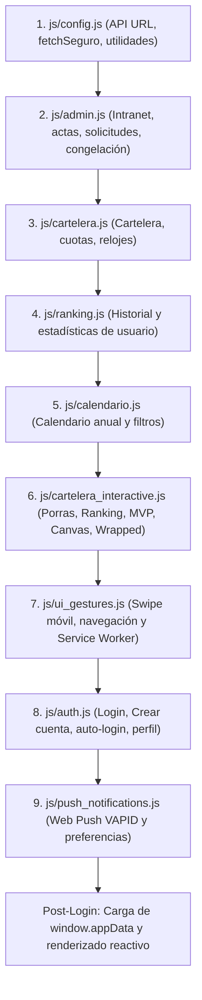

# Guía de Arquitectura Frontend — VCV Play 26/27 (Fantasy VCV)

> **Documento de referencia para desarrolladores y agentes de IA.**  
> Describe la estructura modular del frontend, la responsabilidad de cada archivo, la secuencia de carga y las reglas obligatorias para modificar o ampliar la aplicación sin introducir regresiones.

---

## 1. Filosofía de Arquitectura

El frontend de **VCV Play** evolucionó desde un único archivo monolítico hacia una arquitectura modular desacoplada por responsabilidades. Actualmente, **tanto `dev.html` (entorno de pruebas) como `index.html` (producción en `vcvplay.com`)** cargan los módulos JavaScript externos ubicados en `js/` de forma diferida (`defer`) y versionada mediante parámetros de cache-busting (`?v=...`).

### Regla Fundamental del Runtime
Los módulos JavaScript de `js/` se cargan como **scripts clásicos ordenados** (`<script defer src="js/...">`), **no** mediante `<script type="module">`.
- **Motivo técnico:** Gran parte de la interfaz genera tarjetas y controles dinámicos con *template literals* y manejadores inline en el DOM (`onclick="openPlayerInfo(...)"`, `onclick="cambiarPuntosV2(...)"`, `onclick="votarMvpPartido(...)"`, `onclick="window.abrirModalCompartirPartido(...)"`, etc.). El aislamiento léxico de ES6 Modules impediría que el DOM resolviera esas funciones globales.
- **Resultado:** Todos los módulos comparten el ámbito global (`window`) de forma predecible, manteniendo el código dividido en archivos cohesivos y fáciles de mantener.

---

## 2. Mapa de Archivos

| Área funcional | Archivo | Líneas aprox. |
| :--- | :--- | :--- |
| **Configuración de API (`/api/vcv`), reintentos (`fetchSeguro`), fechas y sanitización** | `js/config.js` | ~733 |
| **Intranet admin: resultados, horarios, solicitudes de registro, usuarios, ligas, MVP, congelación y mantenimiento** | `js/admin.js` | ~4.246 |
| **Cartelera semanal, cuotas comunitarias, relojes de cuenta atrás y pronósticos de temporada** | `js/cartelera.js` | ~939 |
| **Historial de predicciones del usuario, estadísticas personales y filtros por jornada/equipo** | `js/ranking.js` | ~476 |
| **Calendario anual completo, buscador dinámico y filtros por equipo/categoría** | `js/calendario.js` | ~858 |
| **Interacción de porras, clasificación, comparador, Wrapped, votación MVP y generador de tarjetas Canvas** | `js/cartelera_interactive.js` | ~6.340 |
| **Navegación inferior móvil, gestos táctiles (swipe) y registro del Service Worker** | `js/ui_gestures.js` | ~263 |
| **Autenticación, auto-login (`localStorage`), registro público ("Crear cuenta"), modo invitado y perfil** | `js/auth.js` | ~1.786 |
| **Motor Web Push (VAPID), suscripciones Push API, soporte iOS PWA y centro de preferencias** | `js/push_notifications.js` | ~1.398 |
| **Hojas de estilo modulares: tokens, base, layout, componentes, cartelera y admin** | `css/app.css`, `css/*.css` | ~2.450 |
| **Estructura HTML base, modales fijos y control háptico (arquitectura desacoplada)** | `dev.html` / `index.html` | ~2.295 |
| **Service Worker (caché PWA y gestión de notificaciones Push en segundo plano)** | `sw.js` | ~70 |
| **Backend Edge Serverless (Cloudflare Pages Functions + Cloudflare D1)** | `functions/api/vcv.js` | ~5.580 |

---

## 3. Secuencia de Carga y Ciclo de Vida

Al cargarse `dev.html` o `index.html`, los scripts se ejecutan de forma diferida (`defer`) respetando estrictamente este orden de dependencia:

### Motivo del orden de carga
1. **`config.js` en primer lugar:** Define el endpoint `/api/vcv`, variables globales y utilidades compartidas (`fetchSeguro`, formateo de fechas, sanitización de imágenes).
2. **Módulos de vista y negocio (pasos 2 a 7):** Registran las funciones de renderizado y eventos en el ámbito global (`window`) antes de que la sesión sea evaluada.
3. **`auth.js` en el paso 8:** Ejecuta la comprobación de sesión guardada (`localStorage`) o gestiona login, modo invitado y creación de cuenta una vez que todas las vistas ya están disponibles.
4. **`push_notifications.js` en el paso 9:** Inicializa el estado de suscripción VAPID y preferencias cuando ya existe sesión activa y el Service Worker ha sido registrado por `ui_gestures.js`.
5. **Control háptico inline:** Al final de `index.html` / `dev.html`, `window.vcvHaptic` proporciona micro-vibración opcional en navegadores compatibles con `navigator.vibrate`.

---

## 4. Funciones Globales Clave

### Utilidades y Red (`js/config.js`)
- `fetchSeguro(url, options, retries)`: Realiza peticiones HTTP con control anti-caché y reintento ante fallos temporales o cold starts.
- `formatFecha(ts)`: Formatea timestamps en formato español legible (`DD/MM, HH:mm`) en hora peninsular.
- `sanitizeImgUrl(url)`: Valida y adapta URLs de avatares, escudos y fotografías de jugadores.

### Autenticación, Registro y Perfil (`js/auth.js`)
- `verificarAutoLogin()`: Restaura la sesión desde `localStorage` si hay credenciales almacenadas.
- `cerrarSesionApp()`: Limpia la sesión local y vuelve a la pantalla de acceso.
- Flujo de registro **"Crear cuenta"**: Envía `action: 'request_registration'` con validación de honeypot y tiempo mínimo; la cuenta permite acceso inmediato al interesado mientras queda oculta al resto de usuarios hasta aprobación en intranet.

### Cartelera, Pronósticos, MVP y Tarjetas (`js/cartelera.js` y `js/cartelera_interactive.js`)
- `iniciarRelojes()` / `iniciarRelojTotales()`: Mantienen actualizadas las cuentas atrás de cierre de partidos y predicción de temporada.
- `seleccionarSetV2(idPart, setVal)` / `cambiarPuntosV2(idPart, delta)`: Actualizan la predicción de sets y diferencia de puntos.
- `votarMvpPartido(idPart, dorsal)`: Registra el voto MVP validando el cierre estricto configurado.
- `window.abrirModalCompartirPartido(...)` / `window.ejecutarCompartirTarjeta()` / `window.descargarTarjetaCanvas()`: Generan y comparten tarjetas Canvas (cuadradas 1080x1080 y Stories 9:16).
- `switchTabV2(tabName)`: Cambia entre las vistas principales (*Partidos*, *Clasificación*, *Calendario*, *Historial/Perfil*).

### Historial y Calendario (`js/ranking.js` y `js/calendario.js`)
- `renderHistorialV2(data)` / `drawHistorialUI(selectedJornada, selectedEquipo)`: Construyen el desglose histórico de pronósticos, aciertos, plenos y estado de partidos pendientes.
- `renderMatchCardHtml(...)` / `renderMatchResultCardHtml(...)` / `setupCalendarListeners()`: Renderizan la vista anual del calendario y sus filtros.

### Intranet y Administración (`js/admin.js`)
- `renderAdminPanel(...)`: Construye la mesa de administración (partidos, resultados oficiales, solicitudes de registro, gestión de usuarios, ligas, insignias, cambios de nombre, sugerencias y modo mantenimiento).
- Controles de MVP (selección de candidatos, hora de cierre, hora de proclamación y publicación manual) y congelación de clasificaciones.

### Notificaciones Web Push (`js/push_notifications.js`)
- `isPushSupported()`: Verifica soporte de Service Worker y PushManager (incluyendo el requisito de modo standalone PWA en iOS Safari).
- `togglePushDispositivo()`: Activa o desactiva la suscripción VAPID del dispositivo actual.
- `guardarAjustesPush()` / `renderUserPushSettings()`: Persisten y muestran las preferencias individuales de notificaciones en D1.

---

## 5. Reglas de Desarrollo y Buenas Prácticas

1. **Exposición global explícita:** Toda función referenciada desde atributos HTML (`onclick`, `onchange`, etc.) debe declararse como función global clásica o asignarse a `window`.
2. **Acceso defensivo al DOM:** Comprobar siempre que el elemento existe antes de asociar eventos o modificar `innerHTML`.
3. **Cache-busting al modificar scripts:** Al editar cualquier archivo en `js/`, incrementar su parámetro `?v=...` en `dev.html` y (cuando se pase a producción) en `index.html` para evitar que los navegadores o la PWA sirvan versiones antiguas en caché.
4. **Restricciones de iOS Safari en PWA:** Web Push en iOS/iPadOS requiere que el usuario haya añadido la app a la pantalla de inicio. La interfaz debe guiar al usuario de forma clara si abre desde el navegador normal.
5. **Estados desacoplados del MVP:** Mantener siempre separados el *cierre de votación* (impide nuevos votos o cambios) y la *proclamación del ganador* (muestra resultados y ganador).
6. **No modificar `patros.html`:** Es una página institucional independiente de patrocinadores del club; no debe alterarse salvo petición expresa.
7. **Flujo de trabajo `dev.html` -> `index.html`:** Probar los cambios primero en la rama `dev` y `dev.html` antes de sincronizar a `index.html` y subir a `main`.
