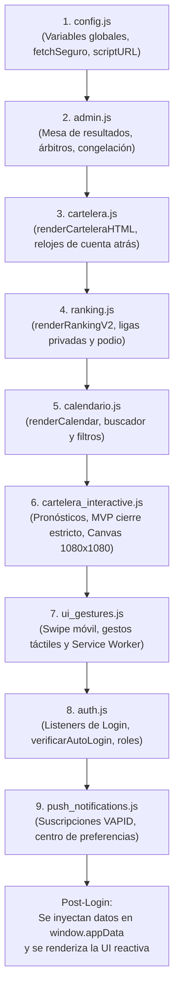

# 🧭 Guía de Arquitectura Frontend — VCV Play (Fantasy VCV)

> **Documento de referencia para Desarrolladores y Agentes de IA.**  
> Este documento describe la estructura modular del frontend, la responsabilidad de cada archivo, el flujo de ejecución del ciclo de vida y las reglas obligatorias para modificar o ampliar el código sin romper dependencias ni introducir regresiones.

---

## 1. 🏛️ Filosofía de Arquitectura

El frontend de **Fantasy VCV** evolucionó desde un archivo monolítico histórico (`index.html`) hacia una arquitectura modular desacoplada organizada por responsabilidades en [`dev.html`](file:///c:/Users/angel/Desktop/fantasy%20vcv%202627/Fantasy-VCV-2627/dev.html) y el directorio [`js/`](file:///c:/Users/angel/Desktop/fantasy%20vcv%202627/Fantasy-VCV-2627/js/).

### ⚠️ Regla Fundamental del Runtime
Los módulos JavaScript en `js/` se cargan como **scripts estándar ordenados** (`<script src="js/...">`), **NO** mediante `<script type="module">`.
* **Motivo técnico:** Toda la interfaz genera bloques dinámicos mediante *template literals* con controladores de eventos inline en el DOM (`onclick="openPlayerInfo(...)"`, `onclick="cambiarPuntosV2(...)"`, `onclick="votarMvpPartido(...)"`, etc.). El aislamiento léxico cerrado de los ES6 modules impediría que los eventos del DOM accedan a estas funciones globales.
* **Resultado:** Todo el código comparte un ámbito global sincronizado (`window`), manteniendo archivos organizados, cohesivos y navegables.

---

## 2. 🗂️ Mapa de Archivos: ¿A dónde acudir para modificar cada función?

Si necesitas hacer una modificación o añadir una funcionalidad, consulta esta tabla para localizar directamente el archivo responsable:

| ¿Qué quieres modificar o ampliar? | Archivo a editar | Líneas aprox. |
| :--- | :--- | :--- |
| **URL de la API Cloudflare D1, reintentos de red (`fetchSeguro`), formato de fechas y sanitización de URLs** | [`js/config.js`](file:///c:/Users/angel/Desktop/fantasy%20vcv%202627/Fantasy-VCV-2627/js/config.js) | ~462 |
| **Intranet de administración, resultados oficiales, horarios, árbitros, congelación de clasificaciones y panel de pruebas** | [`js/admin.js`](file:///c:/Users/angel/Desktop/fantasy%20vcv%202627/Fantasy-VCV-2627/js/admin.js) | ~2.312 |
| **Tarjetas de partidos de la cartelera, cuotas de predicción comunitarias y temporizadores de cuenta atrás** | [`js/cartelera.js`](file:///c:/Users/angel/Desktop/fantasy%20vcv%202627/Fantasy-VCV-2627/js/cartelera.js) | ~777 |
| **Tabla de clasificación (General y ligas privadas), podio, historial por jornadas y predicciones de temporada** | [`js/ranking.js`](file:///c:/Users/angel/Desktop/fantasy%20vcv%202627/Fantasy-VCV-2627/js/ranking.js) | ~727 |
| **Calendario anual de la temporada, buscador dinámico de encuentros y filtros por equipo** | [`js/calendario.js`](file:///c:/Users/angel/Desktop/fantasy%20vcv%202627/Fantasy-VCV-2627/js/calendario.js) | ~290 |
| **Interactividad de predicciones (sets, diferencias), votación MVP VALCYL (cierre estricto, bloqueo) y Canvas social cards** | [`js/cartelera_interactive.js`](file:///c:/Users/angel/Desktop/fantasy%20vcv%202627/Fantasy-VCV-2627/js/cartelera_interactive.js) | ~3.872 |
| **Gestos táctiles móviles (swipe entre pestañas), navegación por pestañas y registro del Service Worker base** | [`js/ui_gestures.js`](file:///c:/Users/angel/Desktop/fantasy%20vcv%202627/Fantasy-VCV-2627/js/ui_gestures.js) | ~263 |
| **Autenticación, formulario de login/registro, auto-login (`localStorage`), roles y perfil de usuario** | [`js/auth.js`](file:///c:/Users/angel/Desktop/fantasy%20vcv%202627/Fantasy-VCV-2627/js/auth.js) | ~1.152 |
| **Motor Web Push (VAPID), suscripciones Push API, banner promocional, preferencias de avisos y panel admin de pruebas** | [`js/push_notifications.js`](file:///c:/Users/angel/Desktop/fantasy%20vcv%202627/Fantasy-VCV-2627/js/push_notifications.js) | ~1.301 |
| **Estructura HTML base, modales fijos (`playerInfoModal`, modales de ajustes, etc.) y diseño Glassmorphism** | [`dev.html`](file:///c:/Users/angel/Desktop/fantasy%20vcv%202627/Fantasy-VCV-2627/dev.html) | ~3.835 |

---

## 3. 🔄 Secuencia de Carga y Flujo del Ciclo de Vida

Al iniciar la aplicación en el navegador, los scripts se ejecutan en este orden riguroso:



### ¿Por qué este orden específico?
1. **`config.js` siempre el primero:** Inicializa las variables de entorno, la URL del backend `/api/vcv` y la función `fetchSeguro`.
2. **Componentes visuales intermedios (2 al 7):** Registran todas las funciones de renderizado (`renderCarteleraHTML`, `renderRankingV2`, `initCalendar`, `votarMvpPartido`, etc.) en el objeto `window`.
3. **`auth.js` en el paso 8:** Cuando se evalúa el formulario de inicio de sesión o se ejecuta `verificarAutoLogin()` con credenciales de `localStorage`, todas las funciones visuales ya están disponibles en memoria, eliminando condiciones de carrera.
4. **`push_notifications.js` en el paso 9:** Requiere que la sesión del usuario ya esté resuelta (para saber su ID, token y preferencias guardadas en D1) y que el Service Worker esté registrado por `ui_gestures.js`.

---

## 4. 🔑 Diccionario de Funciones Globales Clave

### Utilidades y Red (`config.js`)
- `fetchSeguro(url, options, retries)`: Envía peticiones HTTP con control anti-caché y reintento exponencial ante cold starts o caídas de red.
- `formatFecha(ts)`: Convierte timestamps en formato legible en español (`DD/MM, HH:mm`).
- `sanitizeImgUrl(url)`: Sanitiza y adapta URLs de imágenes (soporte HTTPS, Imgur y proxies).

### Autenticación y Perfil (`auth.js`)
- `verificarAutoLogin()`: Lee el token almacenado y restaura la sesión activa sin solicitar credenciales.
- `cerrarSesionApp()`: Elimina datos locales de sesión y reinicia la vista de acceso.
- `abrirAjustesPerfil()`: Despliega el modal de edición de perfil, avatar y configuración de cuenta.

### Cartelera y Pronósticos (`cartelera.js` & `cartelera_interactive.js`)
- `renderCarteleraHTML(data)`: Construye las tarjetas de partidos de la jornada seleccionada.
- `iniciarRelojes()`: Activa los temporizadores regresivos hacia el inicio del partido y cierre de porras.
- `seleccionarSetV2(idPart, setVal)`: Almacena la predicción de sets para un partido.
- `cambiarPuntosV2(idPart, delta)`: Modifica el tanteo de puntos previsto para el desempate.
- `votarMvpPartido(idPart, dorsal)`: Envía el voto de MVP para un jugador. Valida localmente si el plazo de votación (por defecto 12:00) ha finalizado, impidiendo votos extemporáneos o modificaciones.
- `generarTarjetaMvpCanvas(jugador, partido)`: Genera y descarga una imagen 1080x1080 px con marca de agua VALCYL lista para redes sociales.
- `switchTabV2(tabName)`: Alterna entre las pestañas principales (*Cartelera*, *Clasificación*, *Calendario*).

### Clasificación y Ligas (`ranking.js`)
- `renderRankingV2()`: Dibuja el podio de honor, la tabla general de puntos y el selector de ligas privadas.
- `cambiarLigaV2(idLiga)`: Filtra las puntuaciones para mostrar exclusivamente los miembros de una liga privada.

### Intranet y Resultados (`admin.js`)
- `renderAdminPanel(equipos)`: Construye la consola de administración y mesa de actas arbitrales.
- `guardarResultadoAdmin(...)`: Envía a Cloudflare D1 los sets y parciales oficiales de un encuentro.
- `guardarAjusteLigasFreeze(freeze)`: Activa o desactiva la congelación del fin de semana en las clasificaciones.
- `actualizarConfiguracionMvp(cierreHora, proclamacionHora)`: Configura las horas límite de votación y publicación de ganadores.

### Notificaciones Web Push (`push_notifications.js`)
- `isPushSupported()`: Comprueba si el navegador actual soporta Service Worker y PushManager (gestiona la excepción de iOS Safari requiriendo instalación PWA previa).
- `togglePushDispositivo()`: Activa o desactiva la suscripción Web Push en el dispositivo actual mediante suscripción VAPID.
- `guardarAjustesPush()`: Persiste en la base de datos D1 las preferencias de avisos seleccionadas por el usuario (recordatorios de porras, inicio MVP, aviso 1h antes MVP, clasificaciones, resultados).
- `renderUserPushSettings()`: Construye el panel visual de interruptores en los ajustes del usuario.
- `adminEnviarPushPrueba(payload)`: Envía una notificación de prueba instantánea a los dispositivos suscritos desde la intranet.

---

## 5. 🛡️ Buenas Prácticas y Reglas de Desarrollo para IAs y Desarrolladores

Cualquier intervención en este repositorio debe respetar estrictamente estos principios:

1. **Exposición Global Explícita:**  
   Toda función invocada desde atributos HTML (`onclick="..."`, `onchange="..."`, etc.) debe ser declarada como función clásica (`function miFuncion() { ... }`) o asignada explícitamente a `window` (`window.miFuncion = ...`).

2. **Defensividad en Selección del DOM:**  
   Nunca asumas que un elemento existe en el DOM en el momento de ejecutar un script. Emplea siempre comprobaciones defensivas:
   ```javascript
   const btn = document.getElementById('miBoton');
   if (btn) {
       btn.addEventListener('click', handler);
   }
   ```

3. **Restricciones PWA y Notificaciones en iOS Safari:**  
   En dispositivos Apple (iOS / iPadOS), la Web Push API solo está disponible cuando la web ha sido añadida a la pantalla de inicio mediante *"Añadir a la pantalla de inicio"* (modo standalone). El código debe informar educadamente al usuario en Safari si no está en modo PWA en lugar de lanzar errores silenciosos.

4. **Preservación de Estados de MVP y Congelación:**  
   El sistema de MVP tiene dos estados independientes: *Cierre de votación* y *Proclamación del ganador*. Al modificar la lógica de partidos o de la cartelera, asegúrate de mantener ambos estados desacoplados para no publicar el ganador antes de tiempo ni permitir votos una vez alcanzada la hora de cierre.

5. **No tocar `patros.html`:**  
   `patros.html` es una página estática independiente con acuerdos institucionales y de patrocinio del club. No debe ser modificada salvo solicitud explícita del usuario.

6. **Flujo de Trabajo `dev.html` vs `index.html`:**  
   * [`dev.html`](file:///c:/Users/angel/Desktop/fantasy%20vcv%202627/Fantasy-VCV-2627/dev.html) es el banco de trabajo y pruebas en desarrollo que carga la suite modular de [`js/`](file:///c:/Users/angel/Desktop/fantasy%20vcv%202627/Fantasy-VCV-2627/js/).
   * [`index.html`](file:///c:/Users/angel/Desktop/fantasy%20vcv%202627/Fantasy-VCV-2627/index.html) representa el bundle monolítico de producción en `vcvplay.com`.
   * **REGLA DE ORO:** Nunca realices commits directos a producción sin validación previa en `dev.html` y confirmación del usuario.
