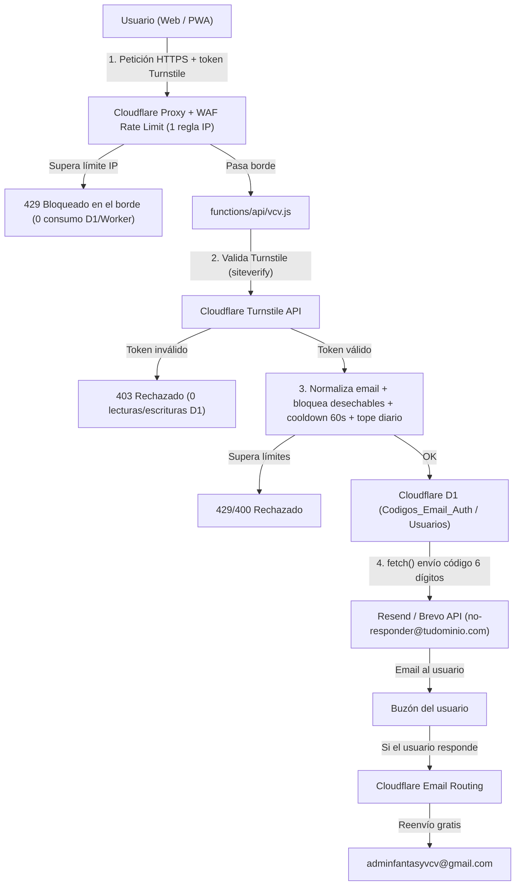

# Plan Técnico: Correo Propio, Recuperación de Contraseña y Registro Seguro en VCV Play 2627

Documento de diseño para integrar un correo profesional del dominio, recuperación automática de contraseña/usuario, verificación de email y registro público protegido contra bots, spam en D1 y ataques DDoS/fuerza bruta.

---

## 1. Arquitectura general (qué cubre cada servicio a 0 €/mes)

En Cloudflare hay dos piezas distintas para el correo:

| Capacidad | Servicio | Coste | Función en VCV Play |
|---|---|---|---|
| **Recibir correos** (`soporte@tudominio.com`, `admin@tudominio.com`) | **Cloudflare Email Routing** | **Gratis** | Reenvía todo el correo entrante al buzón actual (`adminfantasyvcv@gmail.com`). |
| **Enviar correos automáticos** (códigos OTP, bienvenida, avisos) | **Resend** *(100/día, 3.000/mes)* o **Brevo** *(300/día)* vía HTTP `fetch()` desde `functions/api/vcv.js` | **Gratis** | Envía códigos de recuperación, verificación de email y avisos desde `no-responder@tudominio.com` / `soporte@tudominio.com`. |
| **Filtro antibots en formularios** | **Cloudflare Turnstile** | **Gratis (ilimitado)** | Bloquea bots en login/recuperación/registro **antes de tocar D1**. |
| **Limitación de tráfico por IP** | **Cloudflare WAF Rate Limiting** *(1 regla gratis)* + Proxy Naranja | **Gratis** | Corta ráfagas de peticiones `POST` por IP en el borde de Cloudflare y absorbe DDoS. |

> **Importante:** Cloudflare Email Routing gratuito **no envía correos salientes hacia terceros** (el envío nativo *Cloudflare Email Service* hacia usuarios externos requiere plan Workers Paid). Por eso se combina **Email Routing (entrada)** + **API HTTP de Resend o Brevo (salida)**.



---

## 2. Configuración previa en Cloudflare y proveedor de envío

### 2.1. Cloudflare Email Routing (Entrada gratuita)
1. En el panel de Cloudflare del dominio: **Email → Email Routing → Get started**.
2. Aceptar los registros DNS (`MX` y `TXT` SPF) que añade Cloudflare automáticamente para recibir correo.
3. En **Destination addresses**, añadir `adminfantasyvcv@gmail.com` y verificar el enlace que llega al Gmail.
4. En **Routing rules**, crear direcciones personalizadas:
   - `soporte@tudominio.com` → Reenviar a `adminfantasyvcv@gmail.com`
   - `admin@tudominio.com` → Reenviar a `adminfantasyvcv@gmail.com`
   - `no-responder@tudominio.com` → Reenviar a `adminfantasyvcv@gmail.com` *(por si algún usuario responde a un correo automático)*
5. *(Opcional)* Para **responder manualmente desde Gmail dando la cara con `@tudominio.com`**:
   - Activar verificación en 2 pasos en la cuenta Google de `adminfantasyvcv@gmail.com` y crear una *Contraseña de aplicación*.
   - En Gmail → *Configuración → Cuentas e importación → Enviar correo como → Añadir otra dirección*: poner `soporte@tudominio.com`, servidor `smtp.gmail.com`, puerto `587` TLS, usuario `adminfantasyvcv@gmail.com` y la contraseña de aplicación.
   - Ajustar el registro `TXT` SPF del dominio raíz (`@`) para autorizar tanto Cloudflare como Google (y Resend/Brevo si envían desde el dominio raíz).

### 2.2. Proveedor de envío automático (Resend o Brevo)
Se recomienda **Resend** por simplicidad en Workers (`fetch` JSON sin dependencias):
1. Dar de alta el dominio en **Resend** (recomendable usar un subdominio de envío como `mail.tudominio.com` o `send.tudominio.com` para no interferir con los registros `MX` raíz de Cloudflare Email Routing).
2. Añadir en Cloudflare DNS los registros `DKIM` (`TXT`) y `SPF` (`TXT` + `MX` del subdominio de retorno) que indique Resend, además de un registro `_dmarc` (`v=DMARC1; p=none; rua=mailto:adminfantasyvcv@gmail.com`).
3. Generar una `API Key` con permiso solo de envío (*Sending access*).

### 2.3. Cloudflare Turnstile (Antibots)
1. En el panel de Cloudflare: **Turnstile → Add widget**.
2. Asociar el dominio de producción (y `localhost` o el subdominio `.pages.dev` si se prueba en staging; el plan gratuito admite hasta 10–15 hostnames por widget).
3. Modo recomendado: **Managed** (invisible para la gran mayoría de usuarios reales y solo muestra comprobación si detecta comportamiento sospechoso).
4. Guardar:
   - `Site Key` → se pondrá en el HTML/JS cliente (`index.html`).
   - `Secret Key` → variable secreta en Cloudflare Pages.

### 2.4. Regla gratuita de WAF Rate Limiting en Cloudflare
En **Security → WAF → Rate limiting rules → Create rule** (el plan Free permite **1 regla activa**):
- **Expresión:** `(http.request.method eq "POST" and http.request.uri.path eq "/api/vcv")`
- **Umbral sugerido:** p. ej. más de `25` peticiones en `10 seconds` por IP (`ip.src`) —suficiente para que un usuario cargando o guardando porras no salte nunca, pero frena scripts/bots al instante. *(Nota: si se separa el endpoint público de registro/recuperación a `/api/auth`, la regla puede ser mucho más estricta, p. ej. `8` peticiones por `1 minute`, sin afectar al resto de la app).*
- **Acción:** `Block` durante `1 minute` (o `1 hour` en el plan gratuito).

### 2.5. Variables de entorno en Cloudflare Pages (`Settings → Environment variables`)
Configurar como **Secret** (Encrypted) en Production y Preview:
- `RESEND_API_KEY`: clave de API de Resend (o `BREVO_API_KEY`).
- `MAIL_FROM`: por ejemplo `VCV Play 2627 <no-responder@mail.tudominio.com>` (o `@tudominio.com` si se verificó la raíz).
- `MAIL_REPLY_TO`: `soporte@tudominio.com` (recibido en Gmail vía Email Routing).
- `TURNSTILE_SECRET`: clave secreta de Turnstile.
- `ADMIN_ALERT_EMAIL`: `soporte@tudominio.com` *(opcional, para recibir aviso cuando haya nuevas solicitudes pendientes).*

---

## 3. Cambios en la base de datos D1 (`vcv_database`)

### 3.1. Tabla `Usuarios` (aprovechar lo ya existente)
Actualmente `functions/api/vcv.js` ya lee y actualiza `"Correo"` en `Usuarios` (`save_email` en líneas `3731-3745` y respuesta del login en línea `2665`). Se recomienda añadir soporte lazy-migration igual que con `ensureResultadosMvpSchema`:

```sql
ALTER TABLE "Usuarios" ADD COLUMN "correo_normalizado" TEXT;
ALTER TABLE "Usuarios" ADD COLUMN "correo_verificado" INTEGER DEFAULT 0;
ALTER TABLE "Usuarios" ADD COLUMN "fecha_alta" TEXT;
CREATE UNIQUE INDEX IF NOT EXISTS idx_usuarios_correo_norm
  ON "Usuarios"("correo_normalizado")
  WHERE "correo_normalizado" IS NOT NULL AND "correo_normalizado" != '';
```

> **Por qué `correo_normalizado`:** para que nadie pueda registrarse varias veces con `usuario+1@gmail.com` o `u.s.u.a.r.i.o@gmail.com` aprovechando alias del mismo buzón.

### 3.2. Tabla temporal `Codigos_Email_Auth` (OTP de recuperación, verificación y pre-registro)
Evita ensuciar `Usuarios`, `Ligas`, `Permisos_Equipos` o `Insignias` con cuentas sin verificar:

```sql
CREATE TABLE IF NOT EXISTS "Codigos_Email_Auth" (
  "id" INTEGER PRIMARY KEY AUTOINCREMENT,
  "tipo" TEXT NOT NULL,                 -- 'RECOVERY' | 'VERIFY_EMAIL' | 'REGISTER'
  "email_norm" TEXT NOT NULL,
  "email_original" TEXT NOT NULL,
  "usuario_objetivo" TEXT,              -- @usuario (en RECOVERY/VERIFY_EMAIL) o usuario deseado (en REGISTER)
  "codigo_hash" TEXT NOT NULL,          -- SHA-256(codigo_6_digitos + email_norm + tipo) o PBKDF2
  "payload_json" TEXT,                  -- En REGISTER: { nombre_real, password_hash, vinculacion }
  "ip_hash" TEXT,                       -- SHA-256 de CF-Connecting-IP (no guardar IP en claro)
  "intentos" INTEGER DEFAULT 0,         -- Máximo 5 intentos antes de invalidar
  "creado_ts" INTEGER NOT NULL,
  "expira_ts" INTEGER NOT NULL,         -- creado_ts + 15 * 60 * 1000
  "usado" INTEGER DEFAULT 0
);
CREATE INDEX IF NOT EXISTS idx_codigos_email_tipo_ts
  ON "Codigos_Email_Auth"("email_norm", "tipo", "creado_ts");
CREATE INDEX IF NOT EXISTS idx_codigos_ip_ts
  ON "Codigos_Email_Auth"("ip_hash", "creado_ts");
```

### 3.3. Tabla `Solicitudes_Registro` *(para modalidad híbrida recomendada: verificado + aprobación en 1 clic)*
Sigue el mismo patrón que ya usa el proyecto en `Peticiones_Insignias` (`functions/api/vcv.js:3669-3728`):

```sql
CREATE TABLE IF NOT EXISTS "Solicitudes_Registro" (
  "id_solicitud" INTEGER PRIMARY KEY AUTOINCREMENT,
  "usuario_deseado" TEXT NOT NULL,
  "nombre_real" TEXT NOT NULL,
  "password_hash" TEXT NOT NULL,        -- Ya generado con hashPassword() al registrarse
  "email" TEXT NOT NULL,
  "correo_normalizado" TEXT NOT NULL,
  "vinculacion" TEXT,                   -- Ej: "Jugador SM2", "Aficionado", "Familia Juvenil..."
  "estado" TEXT DEFAULT 'PENDIENTE',    -- 'PENDIENTE' | 'APROBADO' | 'RECHAZADO'
  "fecha_solicitud" TEXT NOT NULL,
  "creado_ts" INTEGER NOT NULL,
  "resuelto_por" TEXT,
  "resuelto_ts" INTEGER
);
CREATE INDEX IF NOT EXISTS idx_solicitudes_reg_estado
  ON "Solicitudes_Registro"("estado");
```

---

## 4. Reglas anti-abuso, anti-spam y protección de cuota D1 (en código)

Todas estas validaciones van dentro de `functions/api/vcv.js` **en orden estricto** para minimizar lecturas/escrituras en D1:

1. **Verificación previa de Turnstile (0 consultas D1 si falla):**
   - Llamada `POST https://challenges.cloudflare.com/turnstile/v0/siteverify` con `secret = env.TURNSTILE_SECRET`, `response = body.turnstile_token` y `remoteip = request.headers.get('CF-Connecting-IP')`.
   - Si `success !== true`, responder `403` inmediatamente.

2. **Validación estricta de formato y longitud (0 consultas D1):**
   - `@usuario`: regex `/^[a-zA-Z0-9_.-]{3,24}$/`, rechazando reservados (`invitado`, `admin`, `root`, `system`, `vcv`, etc.).
   - `email`: formato válido, longitud <= 120, y comprobar dominio contra una lista de dominios temporales conocidos (`mailinator.com`, `10minutemail.com`, `tempmail.com`, `guerrillamail.com`, `yopmail.com`, etc.).
   - `password`: mínimo 6 caracteres recomendado en nuevas altas/reseteos.

3. **Normalización de email:**
   - Pasar a minúsculas y trim.
   - Si el dominio es `gmail.com` o `googlemail.com`, quitar todo lo posterior a `+` en la parte local y eliminar puntos `.` de la parte local (ej. `J.uan+vcv@gmail.com` → `juan@gmail.com`).

4. **Límites de frecuencia (*rate limit* lógico en D1/Cache_App):**
   - **Cooldown por email+tipo:** si existe un registro en `Codigos_Email_Auth` con `creado_ts > now - 60_000`, devolver `429` (*"Espera 1 minuto antes de pedir otro código"*).
   - **Tope por hora por email:** máximo `3` códigos en los últimos `3.600.000 ms`.
   - **Tope por hora por IP (`ip_hash`):** máximo `6` códigos en `1 hora` desde la misma IP.
   - **Cortafuegos diario global (protege cuota gratis de Resend y D1):** contador en `Cache_App` con clave `'EMAIL_QUOTA_YYYY-MM-DD'`. Si llega a `85` envíos en un día (dejando margen bajo los 100/día de Resend), bloquear temporalmente nuevas peticiones de registro/código con mensaje claro y mantener operativa toda la app de porras/MVP.

5. **Protección contra enumeración de cuentas:**
   - En `request_password_reset`, si el correo no existe en `Usuarios`, responder exactamente el mismo mensaje y código HTTP `200` neutro: *"Si existe una cuenta con ese correo verificado, recibirás un código en unos instantes"* (sin llegar a llamar a Resend).

6. **Protección del código OTP de 6 dígitos:**
   - Generar con `crypto.getRandomValues` (nunca `Math.random()`).
   - Guardar solo el hash en `Codigos_Email_Auth` y comparar en tiempo constante.
   - Máximo `5` intentos por código; al quinto fallo marcar `usado = 1` o incrementar bloqueo.
   - Purga ocasional (por ejemplo 1 de cada 20 peticiones o en `cleanup`): `DELETE FROM "Codigos_Email_Auth" WHERE expira_ts < ?` para mantener la tabla minúscula.

---

## 5. Diseño de endpoints en `functions/api/vcv.js`

### 5.1. Recuperación de contraseña (y recordatorio de `@usuario`)
- **`action: 'request_password_reset'`**
  - Entrada: `{ email, turnstile_token }`.
  - Flujo: Turnstile → formato/desechable → normalizar → cuota global/IP/cooldown → buscar en `Usuarios` por `"correo_normalizado" = ?` (o `lower("Correo") = ?` como respaldo para correos ya guardados antes de la migración) → si existe, crear OTP de 6 dígitos en `Codigos_Email_Auth` (`tipo = 'RECOVERY'`) → enviar email indicando su `@usuario` (por si también lo olvidó) y el código válido 15 min → responder mensaje neutro.
- **`action: 'confirm_password_reset'`**
  - Entrada: `{ email, code, new_password, turnstile_token }`.
  - Flujo: Turnstile → validar `new_password` → buscar último OTP activo `RECOVERY` para `email_norm` (`usado = 0 AND expira_ts > now AND intentos < 5`) → si el código no coincide, `intentos = intentos + 1` y error → si coincide, generar `hashed = await hashPassword(new_password)` (reutilizando `vcv.js:234`), actualizar `"Usuarios"."Password"`, marcar `usado = 1` y, opcionalmente, mandar email avisando de que la contraseña se cambió.

### 5.2. Verificación de correo desde Perfil
- **`action: 'request_verify_email'`** *(usuario autenticado con `getAuthUser()`)*
  - Entrada: `{ usuario, password, email }` (opcionalmente sin Turnstile al ir autenticado, pero manteniendo cooldown 60s y tope horario).
  - Flujo: comprobar que `email_norm` no está verificado ya en otra cuenta → guardar OTP (`tipo = 'VERIFY_EMAIL'`) → enviar código de 6 dígitos.
- **`action: 'confirm_verify_email'`** *(usuario autenticado)*
  - Entrada: `{ usuario, password, email, code }`.
  - Flujo: validar OTP → actualizar `"Usuarios"` (`"Correo"`, `"correo_normalizado"`, `"correo_verificado" = 1`) → marcar OTP usado.
  - *(Nota: mientras tanto, el flujo legacy `save_email` puede redirigir o convivir durante la transición).*

### 5.3. Registro de cuentas nuevas
Se proponen **dos variantes** (eligiendo una sola en configuración o por flag):

#### Variante A — Verificación por email + Aprobación 1-clic en Intranet *(Recomendada para VCV)*
Evita multicuentas en el ranking y gente ajena con acceso indebido, mientras te ahorra crear usuarios y contraseñas a mano.
1. **`action: 'register_request'`**:
   - Entrada: `{ usuario_deseado, nombre_real, password, email, vinculacion, turnstile_token }`.
   - Comprueba: Turnstile, formatos, dominio no desechable, cuota diaria/IP/cooldown, que `usuario_deseado` no exista en `Usuarios` (case-insensitive) ni en `Solicitudes_Registro` pendiente, y que `email_norm` no exista verificado en `Usuarios`.
   - Hashea `password` **en ese momento** con `hashPassword(password)` y lo guarda dentro de `payload_json` en `Codigos_Email_Auth` (`tipo = 'REGISTER'`). Nunca se guarda la contraseña en texto plano.
   - Envía código OTP de 6 dígitos al email.
2. **`action: 'register_confirm_email'`**:
   - Entrada: `{ email, code, turnstile_token }`.
   - Valida OTP (`REGISTER`), vuelve a comprobar que el `@usuario` y `email_norm` sigan libres, e inserta en `Solicitudes_Registro` (`estado = 'PENDIENTE'`).
   - Opcionalmente envía aviso a `ADMIN_ALERT_EMAIL` (`soporte@tudominio.com`) indicando que hay una solicitud verificada lista para aprobar.
3. **`action: 'admin_get_registro_pendientes'` y `action: 'admin_resolve_registro'`** *(solo `Admin Web === 'X'`)*:
   - Al aprobar desde la intranet, el administrador selecciona las **Ligas iniciales** (por defecto `General` y los equipos asociados en `Ligas_Equipos`, replicando exactamente la transacción en lote de `add_user` en `functions/api/vcv.js:2886-2918`: `Usuarios`, `Permisos_Equipos`, `Permisos_Secreta`, `Insignias`, `Ligas`).
   - Marca la solicitud como `APROBADO` y envía email de confirmación al usuario (*"Tu cuenta @... en VCV Play 2627 ya está activa"*).

#### Variante B — Alta automática inmediata tras verificar email
- Igual en `register_request`, y al validar `register_confirm_email` ejecuta directamente el alta en `Usuarios` + `Permisos_Equipos` + `Permisos_Secreta` + `Insignias` + `Ligas` asignando automáticamente solo la liga pública por defecto (p. ej. `General`) y los equipos de esa liga.

---

## 6. Cambios en el Frontend

1. **Pantalla de Login (`#loginSection` en [index.html](file:///c:/Users/angel/Desktop/fantasy%20vcv%202627/Fantasy-VCV-2627/index.html#L2434-L2490) + [js/auth.js](file:///c:/Users/angel/Desktop/fantasy%20vcv%202627/Fantasy-VCV-2627/js/auth.js)):**
   - Cargar `<script src="https://challenges.cloudflare.com/turnstile/v0/api.js" async defer></script>` solo cuando se abra el modal de *Recuperar contraseña* o *Crear cuenta* (para no ralentizar ni cargar scripts de terceros en el arranque normal del login).
   - Añadir debajo de `#btnLogin`:
     - Enlace discreto: **«¿Olvidaste tu usuario o contraseña?»** → abre modal en 2 pasos (Paso 1: email + widget Turnstile; Paso 2: código de 6 dígitos + nueva contraseña ×2).
     - Botón secundario / enlace junto a `#btnGuest`: **«Crear / Solicitar cuenta nueva»** → abre modal con `@usuario`, nombre real, contraseña, correo electrónico, vinculación con el club y widget Turnstile → paso 2 para introducir el código de 6 dígitos recibido en el email.
   - Sustituir las referencias visibles a `adminfantasyvcv@gmail.com` en FAQ y `#unete` (`index.html:2502, 2534, 2550, 3814, 3821`) por el nuevo correo del dominio (ej. `soporte@tudominio.com`).

2. **Tarjeta de Correo en Perfil ([index.html](file:///c:/Users/angel/Desktop/fantasy%20vcv%202627/Fantasy-VCV-2627/index.html#L3346-L3357) + [js/admin.js](file:///c:/Users/angel/Desktop/fantasy%20vcv%202627/Fantasy-VCV-2627/js/admin.js#L2202)):**
   - Mostrar insignia de estado junto a `#currentEmailDisplay`: `✅ Verificado` o `⚠️ Sin verificar` con botón para pedir código de confirmación.

3. **Intranet Administrador ([index.html](file:///c:/Users/angel/Desktop/fantasy%20vcv%202627/Fantasy-VCV-2627/index.html) + [js/admin.js](file:///c:/Users/angel/Desktop/fantasy%20vcv%202627/Fantasy-VCV-2627/js/admin.js)) *(si se usa Variante A)*:**
   - Añadir sección colapsable **«Solicitudes de nuevas cuentas»** con lista de pendientes (`@usuario`, nombre, email verificado, vinculación), checkboxes de ligas iniciales (`General` marcado por defecto) y botones **✅ Aprobar y crear** / **❌ Rechazar**.

---

## 7. Viabilidad en la capa gratuita

| Recurso | Límite capa gratuita | Consumo estimado VCV Play | Margen |
|---|---|---|---|
| **Cloudflare Email Routing** | Sin límite práctico para un club (reenvío a Gmail) | Decenas de correos/mes | Muy sobrado |
| **Resend (Free)** | 100 emails/día · 3.000/mes | 5–40 emails/día en picos | Protegido con tope en código (85/día) |
| **Cloudflare Turnstile** | Peticiones ilimitadas | Todas las de registro/recuperación | Ilimitado |
| **Cloudflare WAF Rate Limiting** | 1 regla activa gratis por dominio | 1 regla protegiendo `/api/vcv` | Exacto |
| **Cloudflare D1 (Free)** | 5M lecturas/día · 100k escrituras/día | < 200 escrituras extra/día máx. | Protegido por Turnstile + WAF |

---

## 8. Orden recomendado de implementación por fases

1. **Fase 1 — Correo profesional del dominio (sin cambios de backend):**
   - Activar Cloudflare Email Routing hacia `adminfantasyvcv@gmail.com`.
   - Configurar "Enviar correo como" en Gmail (opcional) y actualizar el `mailto:` en `index.html`.
2. **Fase 2 — Envío transaccional + Recuperación y verificación de email:**
   - Dar de alta Resend (DNS + secreto `RESEND_API_KEY`) y Turnstile (`Site Key` + `TURNSTILE_SECRET`).
   - Configurar la regla WAF Rate Limiting en Cloudflare.
   - Implementar migración D1 (`Usuarios` + `Codigos_Email_Auth`), verificación de Turnstile, normalización/filtros y endpoints `request_password_reset`, `confirm_password_reset`, `request_verify_email` y `confirm_verify_email`.
   - Añadir UI de *"¿Olvidaste tu usuario o contraseña?"* en login y estado verificado en Perfil.
3. **Fase 3 — Registro público seguro:**
   - Crear `Solicitudes_Registro` (Variante A) o alta directa limitada (Variante B).
   - Implementar `register_request` / `register_confirm_email` y, si aplica, el bloque de aprobación en 1 clic dentro de la intranet admin.
